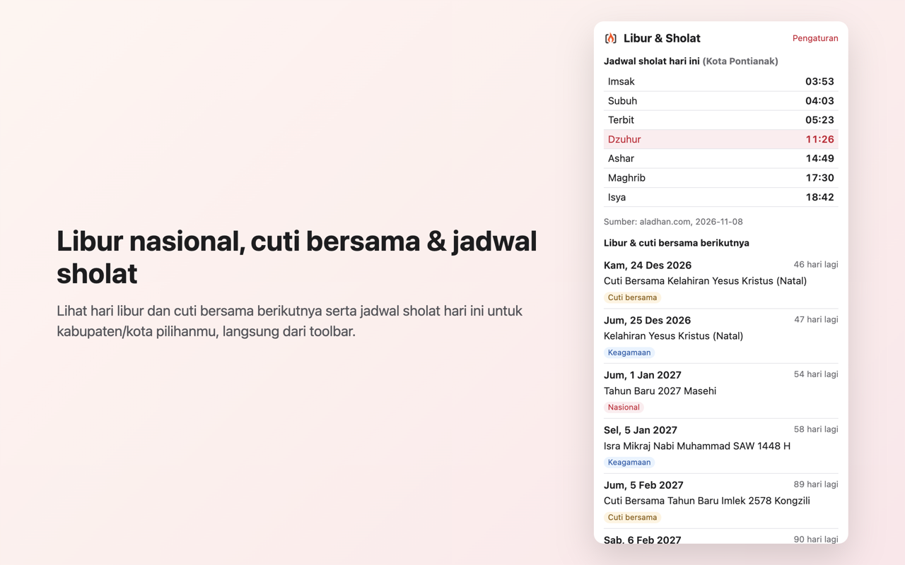

# API Indonesia: Libur & Sholat

A small browser extension (Manifest V3) that shows, from your toolbar:

- the next Indonesian public holidays and cuti bersama (SKB 3 Menteri), and
- today's prayer times for the kabupaten/kota you pick.

Data comes from [API Indonesia](https://apiindonesia.id) using **your own API key**.

## How it works

1. Create a free account and an API key at [dashboard.apiindonesia.id](https://dashboard.apiindonesia.id). New accounts get a one-time 3,000 credit signup bonus, and each successful request costs 2 credits.
2. Open the extension settings, paste the key and click **Simpan & cek**.
3. Search and pick your kabupaten/kota.
4. Click the toolbar icon.

Endpoints used (base `https://use.apiindonesia.id`, header `x-api-key`):

| Endpoint | Used for |
| --- | --- |
| `GET /api/v1/libur/upcoming` | Upcoming holidays and cuti bersama |
| `GET /api/v1/sholat/list-kota` | City list for the settings page (fetched once, then kept locally) |
| `GET /api/v1/sholat?kabupaten_id=…&tanggal=YYYY-MM-DD` | Today's prayer times |

Responses are cached in `storage.local` for the current day, so opening the popup many times does not spend extra credits.

## Privacy

- The API key and chosen city are stored only in the browser's `storage.local`.
- They are only sent to `https://use.apiindonesia.id` to fetch the data above.
- No analytics, no tracking, no remote code. The only host permission is `https://use.apiindonesia.id/*`.
- Privacy policy: https://apiindonesia.id/privacy/

## Install

- Firefox: Firefox Add-ons (listing pending review)
- Microsoft Edge: Edge Add-ons (listing pending review)
- Manual: clone this repo and load the `src/` folder as an unpacked extension (Chrome/Edge: `chrome://extensions` → Developer mode → Load unpacked).

## Build

Plain HTML, CSS and JavaScript, no bundler. `./build.sh` copies `src/` into `dist/chromium` and `dist/firefox` (the Firefox manifest adds `browser_specific_settings`) and zips both.

## Links

- API Indonesia: https://apiindonesia.id
- Docs: https://docs.apiindonesia.id
- Support: contactmuhtadin@gmail.com

Built by Khaisa Studio. MIT licensed.
